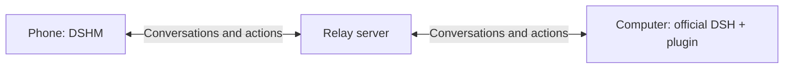

# DSHM Relay Server

[简体中文](./README.md) | English

[Android app](https://github.com/KKUCODES/dshm/blob/main/README.en.md) · [Desktop plugin](https://github.com/KKUCODES/dshm-plugin/blob/main/README.en.md) · **Relay server**

<p align="center">
  
</p>

Connects the DSHM phone app to the computer plugin, handling computer registration, device pairing, authentication, and real-time transport. Official DSH runs the tasks; the phone uses DSHM's own chat interface.



Direct chat connects the phone to DeepSeek without the relay. The backend needs no model API key and does not execute tasks or provide a remote desktop.

## Deploy

**Self-hosting with HTTPS is recommended.** Node.js 24 + Fastify + PostgreSQL. Docker Compose includes the database, gateway, and Caddy; deployment is independent and does not require building the computer plugin.

Prepare Docker Compose, a domain pointing to your server, and TCP ports 80/443. From the backend directory, run:

```sh
cp .env.example .env
```

Edit `.env`: set `DOMAIN` and a random `POSTGRES_PASSWORD`. The default private mode also needs a separate `ENROLLMENT_TOKEN`. See the [deployment guide (Chinese)](./docs/deployment.md) for generating random values and Windows instructions.

```sh
docker compose config --quiet
docker compose up -d --build --wait
docker compose ps
```

Check that `https://your-domain/health` returns `ok: true`. Enter the relay's root URL in the computer plugin, register the computer, and enable the connection. Claim a pairing link on your phone, then verify its fingerprint and approve it on the computer.

| Registration mode | First computer registration |
| --- | --- |
| `private` (default) | Requires an enrollment token. |
| `open` | No enrollment token; phones still need pairing, approval, and authentication. |

Restart the gateway after changing modes. Existing computer credentials remain valid. For local startup, updates, backups, and troubleshooting, see the [deployment guide (Chinese)](./docs/deployment.md).

### Public backend

If you prefer not to self-host, enter the maintainer-provided [public URL](http://118.31.20.47:18787) in the computer plugin:

```text
http://118.31.20.47:18787
```

Registration is open; phones still need pairing and approval. HTTP transport is unencrypted. Use self-hosted HTTPS for sensitive content. Long-term availability and capacity are not guaranteed.

## Operating limits

- Keep the computer and DSH running. The relay does not queue messages while offline or forward computer localhost websites.
- Run only one gateway instance. Connection routing is held in memory; after a restart, clients reconnect and read the computer's current state.
- The database stores bindings, credential hashes, and replay-prevention records, not chat bodies or files. HTTPS is not end-to-end encryption.
- Persist and back up the database. Deleting its data volume loses device authorizations; verify device trust before restoring an older backup.

## Current status

Linux Docker validation covered public-network HTTP transport, pairing, revocation, container restarts, and backup restoration in an isolated environment. **HTTPS and the complete public-network path with real DSH + Android still need validation.**

The core local combination is official DSH `0.2.1-alpha.2` + plugin `0.1.80-latest.0` + the matching Android app. Server address changes in `0.1.81-latest.0` were validated separately. These candidates have no official release yet; see the knowledge catalog for versions and extension limits.

## Development and documentation

```text
packages/gateway/    Registration, pairing, authentication, WebSocket relay, and database
packages/protocol/   Shared protocol for the phone, computer plugin, and relay
deploy/             Reverse proxy configuration and server operations records
tests/              Backend and cross-project integration tests
scripts/            Validation and diagnostic tools
docs/               Deployment, development, and knowledge entry points
```

Detailed guides are currently in Chinese:

- [Deployment guide](./docs/deployment.md): configuration, operation, and backups.
- [Development guide](./docs/development.md): builds and tests; cross-project tests require adjacent projects.
- [Knowledge catalog](./docs/project-knowledge/catalog.md): interfaces and compatibility evidence. Some links depend on the project collection.
