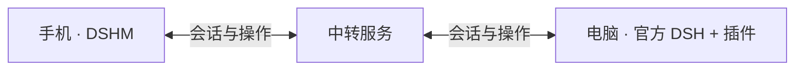

# DSHM Relay · DeepSeek Harness 自建中转服务

简体中文 | [English](./README.en.md)

[DSHM 安卓客户端](https://github.com/KKUCODES/deepseek-harness-mobile) · [DSHM 电脑插件](https://github.com/KKUCODES/dshm-plugin) · **DSHM 中转服务**

**DSHM Relay** 是可以自行部署的 WebSocket 中转服务，连接 [DSHM 安卓客户端](https://github.com/KKUCODES/deepseek-harness-mobile)与电脑端 [DeepSeek Harness（DSH）](https://github.com/deepseek-ai/deepseek-harness) 插件。它负责注册、配对、鉴权和实时传输，让手机与电脑同步会话与操作；任务由电脑 DSH 执行。

[Docker Compose 部署](#使用-docker-compose-部署中转服务) · [完整部署指南](./docs/deployment.md) · [公共中转地址](#使用公共中转服务) · [常见问题](#常见问题)

<p align="center">
  
</p>



普通聊天由手机直连 DeepSeek，不经过中转。后端无需模型 Key，也不执行任务或提供远程桌面。

## 使用 Docker Compose 部署中转服务

**推荐自建 HTTPS。** Node.js 24 + Fastify + PostgreSQL；Docker Compose 包含数据库、网关与 Caddy，可独立部署，无需构建电脑插件。

准备 Docker Compose、指向服务器的域名及 TCP 80/443。在后端目录执行：

```sh
cp .env.example .env
```

编辑 `.env`：填写 `DOMAIN`、随机 `POSTGRES_PASSWORD`；默认个人模式还需独立的 `ENROLLMENT_TOKEN`。生成随机值与 Windows 步骤见[部署指南](./docs/deployment.md)。

```sh
docker compose config --quiet
docker compose up -d --build --wait
docker compose ps
```

确认 `https://你的域名/health` 返回 `ok: true`。电脑插件填写根地址、注册并开启连接；手机领取配对链接，电脑核对指纹并批准。

| 注册模式 | 首次注册电脑 |
| --- | --- |
| `private`（默认） | 需要注册密钥。 |
| `open` | 免注册密钥，手机仍需配对、批准与鉴权。 |

切换模式后重启网关，已有电脑凭据继续有效。本地启动、更新、备份与排障见[部署指南](./docs/deployment.md)。

### 使用公共中转服务

不想自建，可在电脑插件填写维护者提供的[公共地址](http://118.31.20.47:18787)：

```text
http://118.31.20.47:18787
```

开放注册，手机仍需配对和批准。HTTP 传输未加密，敏感内容建议自建 HTTPS；不承诺长期可用性或容量。

## 运行边界

- 电脑和 DSH 保持运行。离线不代存消息，不转发电脑 localhost 网站。
- 只运行一个网关实例；连接路由在内存中，重启后客户端重连并读取电脑状态。
- 数据库保存绑定、凭据摘要与防重放记录，不保存聊天正文或文件。HTTPS 不等于端到端加密。
- 持久化并备份数据库。删除数据卷会丢失授权；恢复旧备份前核对设备信任。

## 当前状态

Linux Docker 的 HTTP 公网通信、配对、撤销、容器重启和隔离备份恢复已验。**HTTPS 与真实 DSH + Android 的完整公网链路仍待验。**

核心本地组合为官方 DSH `0.2.1-alpha.2`＋插件 `0.1.80-latest.0`＋原配套 Android；`0.1.81-latest.0` 的地址修改另验。手机已提供公开开发预览，插件 Actions 提供 `0.1.82-latest.0` 构建包；这些下载入口不代替原组合的完整兼容结论。[插件版本与下载](https://github.com/KKUCODES/dshm-plugin#当前状态)

## 常见问题

### 电脑需要公网 IP 或映射 DSH 网页端口吗？

电脑插件主动连接中转，手机也连接同一个中转地址，因此无需直接将电脑的 DSH 网页端口暴露到公网。手机和电脑的网络都要能访问中转服务；首版不提供电脑 localhost 网站转发。

### 中转服务器会保存聊天和项目文件吗？

当前数据库不保存聊天正文或文件内容，只保存绑定、凭据摘要与防重放记录。会话和文件通过中转传输；HTTPS 不等于端到端加密。持久数据和日志范围见[部署与备份说明](./docs/deployment.md)。

### 开放注册后，任何人都能访问我的电脑吗？

不能。`open` 仅免除首次注册电脑所需的注册密钥；手机访问仍需一次性配对、电脑批准及后续请求鉴权。

## 开发与文档

```text
packages/gateway/    注册、配对、鉴权、WebSocket 中转与数据库
packages/protocol/   手机、电脑插件与中转共用的协议
deploy/             反向代理配置与服务器运维记录
tests/              后端与跨端联调测试
scripts/            验证和诊断工具
docs/               部署、开发与知识库入口
```

- [部署指南](./docs/deployment.md)：配置、运行与备份。
- [开发指南](./docs/development.md)：构建与测试；跨端测试需相邻项目。
- [知识库](./docs/project-knowledge/catalog.md)：接口与兼容资料，部分链接依赖项目集合。
