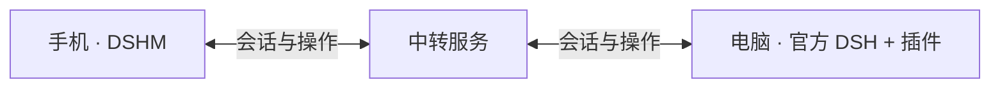

# DSHM 中转服务

**把手机和电脑连起来，离开电脑也能继续推进工作。**

这是 DSHM 的连接后端。电脑上的 DSHM 插件主动连接服务，经过配对和批准的手机便能读取会话、发送消息、接收执行结果和处理审批。任务仍由电脑端的官方 DeepSeek Harness（DSH）执行，手机使用 DSHM 自己的聊天页面。



DSHM 的普通聊天使用手机自己的 DeepSeek Key 直连模型，不经过本服务。**只有连接电脑的 Remote 能力需要中转，后端启动不需要配置模型 Key。**

## 它负责什么

| 能力 | 作用 |
| --- | --- |
| 连接电脑 | 接收电脑插件的主动连接，转发已授权设备的请求。 |
| 配对设备 | 处理五分钟有效、领取后失效的一次性链接，等待电脑批准。 |
| 实时传输 | 中继聊天、执行事件、文件分片与手机操作，不在后端执行任务。 |
| 管理访问 | 检查设备身份与权限；撤销设备后断开连接，电脑管理权限另行授予。 |

无需注册用户账号。电脑和 DSH 必须保持运行；电脑离线时，中转不会代存待发送消息。服务也不提供远程桌面或电脑 localhost 网站转发。

## 开始使用

**推荐自行搭建，并为公网连接启用 HTTPS。** 服务使用 TypeScript、Node.js 24、Fastify 和 PostgreSQL；仓库提供 Docker Compose，由 Caddy 处理 HTTPS 和 WebSocket。

### 自建后端

准备 Docker Compose、指向服务器的域名，以及公网 TCP 80/443。在本仓库目录执行：

```sh
cp .env.example .env
```

编辑 `.env`：填写 `DOMAIN`，设置随机数据库密码 `POSTGRES_PASSWORD`；默认个人模式还需独立的 `ENROLLMENT_TOKEN`。随机值生成方式及 Windows 操作见[部署指南](./docs/deployment.md)。

```sh
docker compose config --quiet
docker compose up -d --build --wait
docker compose ps
```

确认 `https://你的域名/health` 返回 `ok: true`，然后在电脑插件中填写 `https://你的域名`，注册电脑、开启连接，生成链接并在手机领取，最后回到电脑核对指纹并批准。

| 注册模式 | 首次注册电脑 |
| --- | --- |
| `private`（默认） | 需要注册密钥，适合自己的服务。 |
| `open` | 不需要注册密钥，适合向其他人开放注册。 |

**开放注册仍需手机配对和电脑批准，并保留后续鉴权。** 修改模式后重启网关，已注册电脑的凭据继续有效。

本服务可独立部署，不必复制或构建电脑插件。完整配置、本地启动、更新与备份见[部署指南](./docs/deployment.md)。

### 使用公共后端

暂时不想搭建，可以在电脑插件的“服务地址”填写维护者提供的[公共中转地址](http://118.31.20.47:18787)：

```text
http://118.31.20.47:18787
```

该服务开放注册，无需注册密钥，手机仍需配对和电脑批准。目前使用 HTTP，传输未加密；敏感内容建议使用自建 HTTPS 服务。公共地址不承诺长期可用性或使用容量。

## 数据与运行边界

- PostgreSQL 保存电脑、设备、配对、凭据摘要和防重放记录，聊天正文和文件内容不写入数据库。中转过程仍经过服务器，HTTPS 保护传输，不代表端到端加密。
- 连接路由保存在网关内存中，当前只部署一个网关实例。服务重启会断开在线连接，重新连接后读取电脑上的状态。
- 数据库必须持久化并备份。停止 Compose 保留数据卷；删除数据卷会丢失绑定和授权记录。恢复旧备份前须核对设备信任状态。

## 当前状态

核心 Remote 的本地验收基线为官方 DSH **`0.2.1-alpha.2`**、独立插件 **`0.1.80-latest.0`** 和配套 Android 候选，使用官方 Web + MuMu。地址修改的插件候选为 `0.1.81-latest.0`，按 DSH 版本分别构建，安装包不能混用。候选尚未正式发布；具体扩展与版本范围通过知识库中的支持清单查阅。

电脑端无需修改或重新构建 DSH。本地固定组合通过不代表任意 DSH 版本、模型或第三方插件都兼容。

后端已在 Linux Docker 环境完成 HTTP 公网协议通信、配对、撤销、容器重启与隔离备份恢复验证。**HTTPS 部署和真实 DSH + Android 的完整公网使用仍需验证**；不能把本地或协议客户端结果当作完整公网验收。

## 开发与文档

```text
packages/gateway/    注册、配对、鉴权、WebSocket 中转与数据库
packages/protocol/   手机、电脑插件与中转共用的协议
deploy/             反向代理配置与服务器运维记录
tests/              后端与跨端联调测试
scripts/            验证和诊断工具
docs/               部署、开发与知识库入口
```

- [部署指南](./docs/deployment.md)：自建、本地运行、配置、更新和备份。
- [开发指南](./docs/development.md)：构建、测试与协议客户端；跨端测试需要相邻项目。
- [后端知识库](./docs/project-knowledge/catalog.md)：架构、接口与兼容验证资料。部分资料位于项目集合中，独立克隆时需配套查阅。
